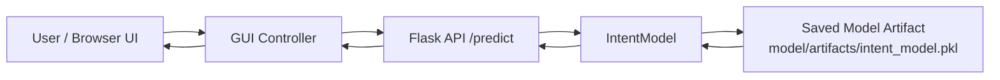
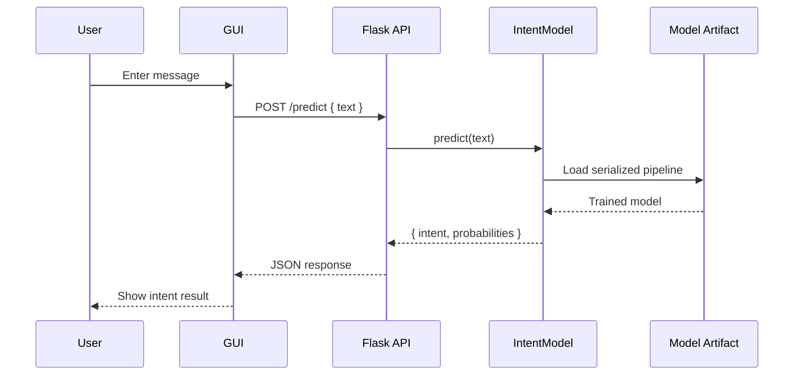

# GUI Architecture

This project is a lightweight intent-classification service with a simple API-first architecture. The GUI layer can be added on top of the Flask backend without changing the training or inference logic.

## High-level architecture



## Layered breakdown

### 1. Presentation layer
The GUI layer is responsible for:

- Accepting user text input
- Showing loading indicators while the request is in progress
- Displaying the predicted intent and confidence values
- Handling validation errors for empty or invalid input

This layer can be implemented in HTML/CSS/JavaScript, a desktop app shell, or a lightweight web framework. The simplest version is a browser page with a textarea and a submit button.

### 2. Application layer
The Flask app in `app.py` acts as the orchestration layer between the UI and the ML model. It performs the following tasks:

- Parses the JSON request body
- Extracts the `text` field
- Validates that input is present
- Calls the model prediction method
- Serializes the result back to JSON

Key route:

- `POST /predict` -> returns the predicted intent
- `GET /health` -> verifies the service status

### 3. Model layer
The `IntentModel` class in `model/intent_model.py` loads the saved pipeline and performs inference.

Responsibilities:

- Load the trained artifact during service startup
- Convert raw user text into vectorized features
- Run the trained classifier
- Return the predicted label and probability information

### 4. Persistence and artifacts
The trained model is stored in:

```text
model/artifacts/intent_model.pkl
```

This artifact is produced by `model/train.py` and loaded by the runtime when the Flask service starts.

## Request flow



## Recommended GUI design

A practical local GUI for this project would include:

- Input box for user text
- Predict button
- Output card showing the predicted intent
- Confidence indicator or probability list
- Error message area for invalid input or service failures

Example UI components:

- `Textarea`: user message input
- `Submit Button`: starts the API call
- `Result Panel`: displays intent label and scores
- `Status Badge`: shows whether the backend is online

## Why this architecture works well

This structure keeps responsibilities separate:

- The model logic is isolated from the interface.
- The backend provides a clean API contract for any frontend.
- The GUI can be replaced without retraining the model.
- Local deployment stays simple and easy to debug.

## Suggested extension

For a more complete user experience, the GUI can later be upgraded to:

- a browser-based interface using HTML/JS
- a desktop app using Tkinter or PyQt
- a Streamlit dashboard
- a React frontend consuming the Flask API

This architecture already supports those options because the prediction logic remains behind a stable API boundary.
