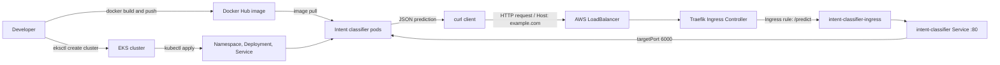

# Intent Classifier Model - Local Deployment Demo

This project demonstrates how to train a lightweight text-classification model for intent detection and expose it through a local Flask API. It is useful as a small ML demo, a backend service for a chatbot, or a base for a simple local GUI or web app.

## Overview

The workflow is intentionally simple:

- A small training script builds a text classifier from example phrases.
- The trained pipeline is saved as a serialized model artifact.
- A Flask app loads the artifact and serves predictions through a `/predict` endpoint.
- The API can be integrated into a front-end or GUI layer for user interaction.

## Project structure

- `app.py` - Flask application that exposes prediction endpoints.
- `model/train.py` - Trains the intent classifier and saves the model artifact.
- `model/intent_model.py` - Loads the saved model and performs inference.
- `model/artifacts/intent_model.pkl` - Serialized trained model.
- `requirements.txt` - Python dependencies for the project.
- `wsgi.py` - WSGI entry point for deployment frameworks.

## Step 1: Create a virtual environment

From the project root, create and activate a Python virtual environment:

```bash
python3 -m venv .venv
source .venv/bin/activate
```

## Step 2: Install dependencies

```bash
pip install -r requirements.txt
```

This installs Flask, scikit-learn, joblib, pytest, and gunicorn.

## Step 3: Train the model

Run the training script:

```bash
python model/train.py
```

This creates the model file:

```text
model/artifacts/intent_model.pkl
```

The training script uses a simple `CountVectorizer` + `MultinomialNB` pipeline on a few example phrases such as greeting, complaint, question, and praise.

## Step 4: Start the Flask API

Launch the app locally:

```bash
python app.py
```

The service will run on:

```text
http://127.0.0.1:6000
```

## Step 5: Check service health

Use this endpoint to confirm the server is live:

```bash
curl http://127.0.0.1:6000/health
```

Example response:

```json
{"status":"ok"}
```

## Step 6: Send a prediction request

Example request:

```bash
curl -X POST http://127.0.0.1:6000/predict \
  -H "Content-Type: application/json" \
  -d '{"text":"I want to cancel my subscription"}'
```

Example response:

```json
{
  "intent": "complaint"
}
```

The actual model also exposes probability values internally through the model pipeline and can be extended to return them in the API response if needed.

## Optional: Run with WSGI

If you want a production-style server entry point:

```bash
gunicorn --bind 0.0.0.0:6000 wsgi:app
```

## Deploy this branch to AWS EKS

The `kubernetes` branch deploys the Flask intent-classifier container to an
Amazon EKS cluster. The Deployment runs two application pods, the
`intent-classifier` Service exposes them inside the cluster, and Traefik
Ingress routes external `/predict` requests to that Service.

### Request and deployment flow



### Step 1: Install and configure the tools

Install the AWS CLI, `eksctl`, `kubectl`, Docker, and Helm. Configure AWS
credentials and confirm that the account can create EKS and load-balancer
resources:

```bash
aws configure
aws sts get-caller-identity
```

### Step 2: Create the EKS cluster

This example uses the cluster name and region referenced by this branch's
cluster instructions:

```bash
eksctl create cluster \
  --name my-cluster \
  --region us-east-1 \
  --version 1.32 \
  --nodegroup-name standard-workers \
  --node-type t3.medium \
  --nodes 2 \
  --nodes-min 1 \
  --nodes-max 3 \
  --managed
```

Configure `kubectl` and confirm the worker nodes are ready:

```bash
aws eks update-kubeconfig --region us-east-1 --name my-cluster
kubectl get nodes
```

### Step 3: Build and push the application image

The Kubernetes Deployment currently references
`hikmatsaud/intent-classifier-model:v1`. Build and push that exact image, or
change the `image` value in `05-k8s-manifest/deployment.yml` to the image
repository and tag you publish:

```bash
docker login
docker build -t hikmatsaud/intent-classifier-model:v1 .
docker push hikmatsaud/intent-classifier-model:v1
```

The Dockerfile trains the model while building the image, and Gunicorn serves
the Flask app on port `6000`.

### Step 4: Install Traefik with an AWS load balancer

Install the Traefik Helm chart in its own namespace and expose its Service as a
cloud load balancer. AWS provisions the load balancer for this Service:

```bash
helm repo add traefik https://traefik.github.io/charts
helm repo update
helm install traefik traefik/traefik \
  --namespace traefik \
  --create-namespace \
  --set service.type=LoadBalancer
```

Wait for Traefik to become ready and for AWS to assign an external address:

```bash
kubectl get pods,svc -n traefik
```

### Step 5: Apply the application manifests

From the repository root, apply the namespace, Deployment, and Service:

```bash
kubectl apply -f 05-k8s-manifest/
```

The namespace is `intent-namespace`. The Deployment creates two replicas; the
Service selects pods labeled `app: intent-classifier`, accepts traffic on port
`80`, and forwards it to container port `6000`. Check that the pods are ready:

```bash
kubectl get pods,svc -n intent-namespace
```

### Step 6: Apply the Ingress rule

The Ingress manifest routes requests with host `example.com` and path
`/predict` to the `intent-classifier` Service on port `80`:

```bash
kubectl apply -f 06-ingres.yml
kubectl get ingress -n intent-namespace
```

### Step 7: Send a prediction request with curl

Get the external hostname or IP address from the Traefik Service:

```bash
kubectl get svc traefik -n traefik
```

Set `INGRESS_HOST` to the `EXTERNAL-IP`/hostname shown by that command, then
send a request. The `Host` header is required because the Ingress rule matches
`example.com`; DNS does not need to point to that name for this test:

```bash
INGRESS_HOST=$(kubectl get svc traefik -n traefik \
  -o jsonpath='{.status.loadBalancer.ingress[0].hostname}{.status.loadBalancer.ingress[0].ip}')

curl -X POST "http://${INGRESS_HOST}/predict" \
  -H "Host: example.com" \
  -H "Content-Type: application/json" \
  -d '{"text":"I want to cancel my subscription"}'
```

The response is JSON containing the predicted intent, for example:

```json
{"intent":"complaint"}
```

To test `/health`, which is not included in the current Ingress paths, forward
the Service port locally in a separate terminal:

```bash
kubectl port-forward -n intent-namespace svc/intent-classifier 6000:80
curl http://127.0.0.1:6000/health
```

When finished, delete the EKS cluster to avoid ongoing AWS charges:

```bash
eksctl delete cluster --name my-cluster --region us-east-1
```

## Troubleshooting

- If you see a `ModuleNotFoundError`, ensure your virtual environment is activated and dependencies are installed.
- If the model file is missing, run `python model/train.py` before starting the API.
- If port 6000 is already in use, change the port in `app.py` and restart the service.

## GUI architecture

A graphical interface can be added on top of this API using a browser-based frontend that sends text input to the Flask backend and displays the returned intent. See [GUI_ARCHITECTURE.md](./GUI_ARCHITECTURE.md) for the UI and interaction design.
